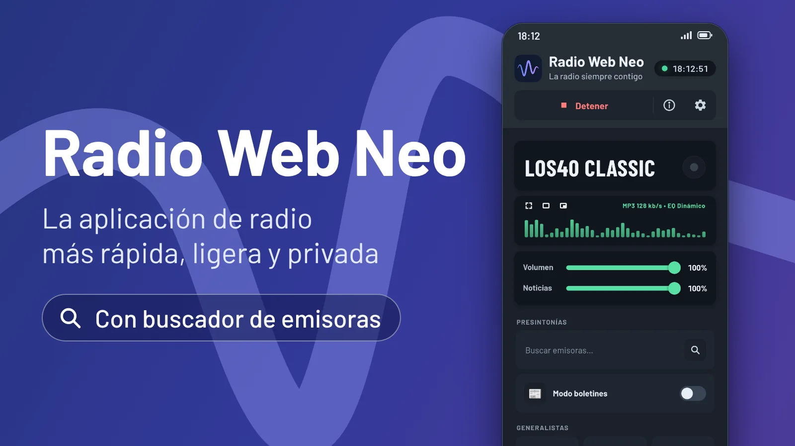
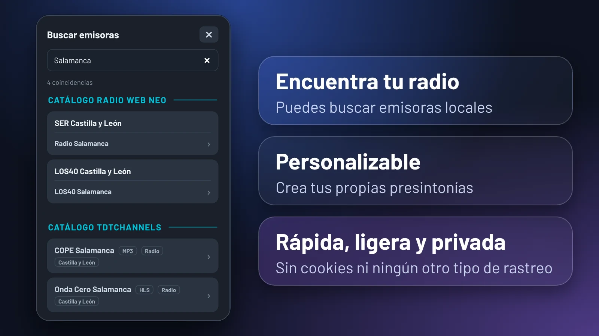
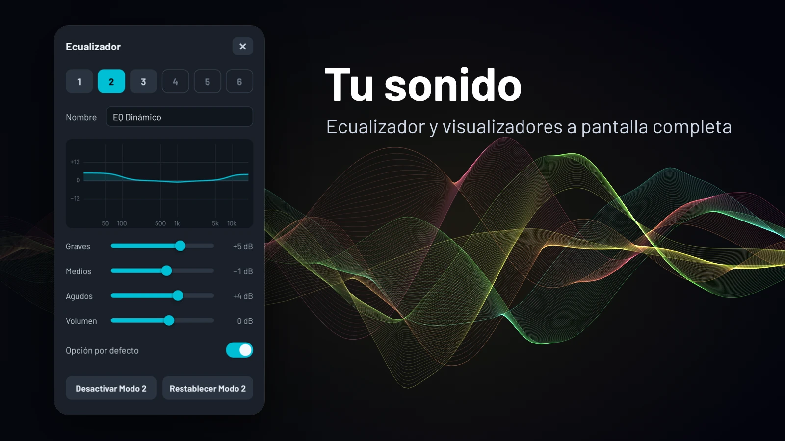
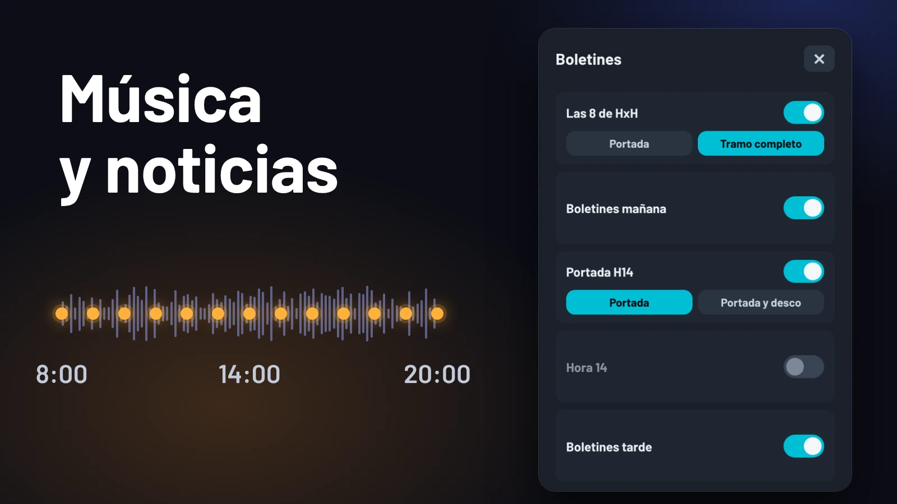
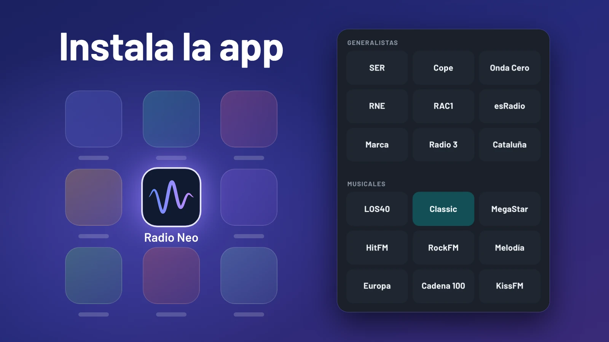

# Radio Web Neo

Reproductor de radio *vibecodeado*, ligero, rápido y sin rastreos: **[radioneo.pages.dev](https://radioneo.pages.dev/)**

Es una versión renovada de [Radio Web Fast](https://github.com/ManuRS/radio_web_fast), con una interfaz más compacta y centrada en el texto y más opciones:

- Buscador de emisoras
- Ecualizador con modos propios y visualizador a pantalla completa con 7 efectos
- Modo boletines: música y, a su hora, las noticias de una generalista
- Grabación en MP3 e imagen en imagen
- Se instala como una app más desde el navegador; sin cookies ni ningún otro tipo de rastreo

## Presintonías

Cada presintonía es una **cadena**, que puede reunir varias **emisoras** (varios streams de audio). Al abrir la aplicación por primera vez vienen cargadas unas de ejemplo:

- Cadenas con varias emisoras, como la SER o LOS40. Con un clic derecho o una pulsación larga sobre la presintonía aparece la lista
- Cadenas que reúnen emisoras con otro criterio, como Italia (radios italianas) o Televisión
- Cadenas con una sola emisora, como Onda Cero o MegaStar. Se les pueden añadir más

No hace falta reunir todas las emisoras de una cadena en una presintonía: si prefieres, crea una presintonía por emisora. Las presintonías se reordenan arrastrándolas

## Buscar y añadir emisoras

Pulsa la barra de búsqueda, escribe parte del nombre y elige una opción del catálogo. Después:

- Añádela a una cadena que ya tengas, eligiendo la cadena y el nombre de la emisora (vienen rellenos, pero se pueden cambiar)
- O crea una presintonía nueva: nombre, nombre corto, tipo (generalista o musical), color y nombre de la emisora

Si tienes el enlace del stream:

- Para una cadena que ya existe: clic derecho o pulsación larga sobre ella, "Añadir emisora…" y la pestaña "Tengo un enlace"
- Para una presintonía nueva: el botón + al final de Generalistas o de Musicales (el tipo ya viene elegido) y la pestaña "Tengo un enlace"

En esas dos ventanas, la pestaña "Consultar catálogo" es el buscador: lo que elijas va directamente a esa cadena o a la presintonía nueva

## Sonido

- Ecualizador: en su panel se cambia de modo con ‹ y ›, y debajo se ve la calidad del audio. El botón de la derecha abre su ventana: en cada modo (1 a 6) se cambian el nombre, los graves, los medios, los agudos y el volumen, y la gráfica muestra cómo queda. Los modos se activan o desactivan (de serie, el 4, el 5 y el 6 vienen desactivados), uno puede ser la opción por defecto y cada uno se puede restablecer
- Visualizador: los botones del panel de las barras abren la pantalla completa, con 7 efectos, y la imagen en imagen
- Grabación: el botón rojo junto al nombre de la emisora graba en MP3

## Boletines

Con el modo boletines activado suena tu emisora y, a la hora de las noticias, conecta sola con una generalista. Por defecto, con las de la SER de 8 a 20 horas

El lápiz del panel abre su ventana. Ahí se elige quién da las noticias:

- Con la Cadena SER guiada aparece su horario y se enciende o apaga cada boletín (en algunos se elige además la duración). "Restablecer" vuelve a la selección de siempre
- Con la SER en lista manual o con otra cadena, escribe las franjas de inicio a fin y añade las que quieras con "+ Añadir franja"

Lo de cada opción se guarda al cambiar de una a otra

## Instalar y ajustes

Desde el menú del navegador puedes instalar la web como una aplicación más del móvil o del PC

En los ajustes (engranaje de la cabecera):

- Preferencias: retrasos del reloj y de la señal, salida de audio, normalizar volumen, color por defecto, color de cada cadena, Material Design (desactivado, estándar o extremo) y, en el móvil, agrupar las opciones de sonido
- Datos: exportar e importar la configuración, script de personalización, caché de sonidos, restablecer la aplicación y registro

Para llevar tu configuración a otro dispositivo:

1. En el origen, Ajustes > Datos > "Exportar": se descarga `radio_web_neo.json`, un JSON legible (si lo editas a mano, tus comentarios se conservan al importarlo)
2. En el destino, Ajustes > Datos > "Importar" y elige ese archivo
