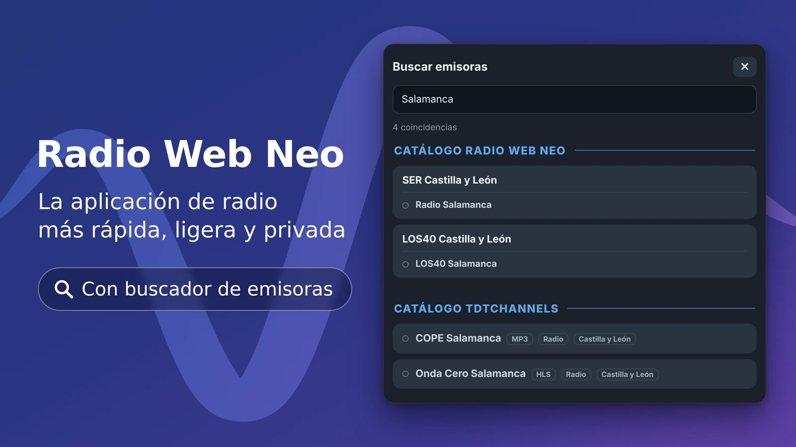
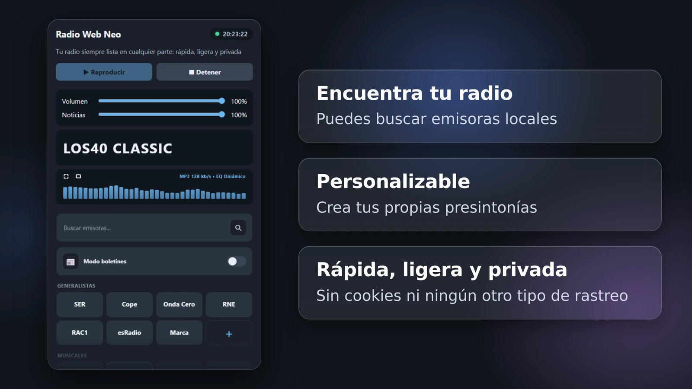

# radio_web_neo

Reproductor de radio *vibecodeado*. Es una versión renovada de [Radio Web Fast](https://github.com/ManuRS/radio_web_fast)

- Tiene una interfaz distinta: Más compacta y centrada en el texto

- Menor sencillez, más opciones: Soporta ecualizaciones y buscar emisoras

- Incluye un visualizador del sonido en tiempo real con 7 efectos diferentes

## Guía de uso

Las presintonias de Neo funciona como CADENAS/GRUPOS, es decir, pueden almacenar varias EMISORAS (varios streams de audio). Por defecto, cuando se abre la aplicación por primera vez hay cargados ejemplos de presintonías:

- Ejemplo de CADENA: Es una presintonía que agrupa a varias de las emisoras de la cadena en cuestión. Al hacer click derecho o dejar apretada la celda con el dedo aparecerá la lista. La SER y Los 40 vienen configuradas de esta manera con unas cuantas emisoras de ejemplo.

- Ejemplo de GRUPO: La lógica interna del programa es la misma, pero conceptualmente se puede hacer un uso de las agrupaciones distinto al de crear cadenas. Se pueden agrupar streams con otro criterio. Por defecto, hay una presintonía con radios italianas y otra con televisiones.

- También hay presintonías que contienen una sola señal (emisora): Onda Cero o MegaStar vienen así por defecto. Se pueden añadir más emisoras a una presintonía.

- No es necesario añadir las emisoras de una cadena en su presintonía. ¿Que significa esto? Que si no te gusta el botón unificado de la SER, puedes crear tantas presintonías como quieras, con una sola emisora cada una.

- Además es posible reordenar las presintonías arrastrándolas a la posición deseada.

## Añadir cadenas y emisoras: búsqueda

La manera más facil de añadir una emisora es pulsando en la barra de búsqueda y escribiendo parte de su nombre. Aparecerá un menú en el que seleccionar una opción de catálogo disponible. Tras hacer elegir una opción:

- Puedes añadir el stream a una cadena ya existente (esto es, incluirla en uno de los paneles que ya tienes): Elige a que cadena se añade y su nombre (el sistema rellena los datos por defecto, pero puedes personalizarlos)

- Puedes crear una nueva presintonia (un nuevo panel): En este caso debes elegir el nombre de la presintonía, su nombre corto, su tipo (generalista o musical), su color de énfasis y el nombre de la emisora con la que nacerá (por defecto es el nombre del stream que has seleccionado)

## Añadir cadenas y emisoras: url

Si cuentas con un enlace, puedes añadir directamente el stream a tu aplicación:

- Para añadirlo a una presintonía existente: 1. Sobre el panel deseado, hacer clic derecho en PC o mantener pulsado en el movil / 2. Seleccionar añadir emisora / 3. Indicar la URL y el nombre deseado

- Para añadirlo creando una nueva presintonía: 1. Pulsar sobre el reloj para mostrar los ajustes / 2. Pulsar en la pestaña de Cadena / 3. Rellenar los datos solicitados

## Exportar configuración

En el origen:

1. Pulsa sobre el reloj para mostrar los ajustes
2. Pulsa en la pestaña de Configuración
3. Copia el texto del cuadro de edición y guardaló en un archivo

En el destino:

1. Abre de nuevo los ajustes y la configuración
2. Pega el texto con tu configuración
3. Aprieta guardar
